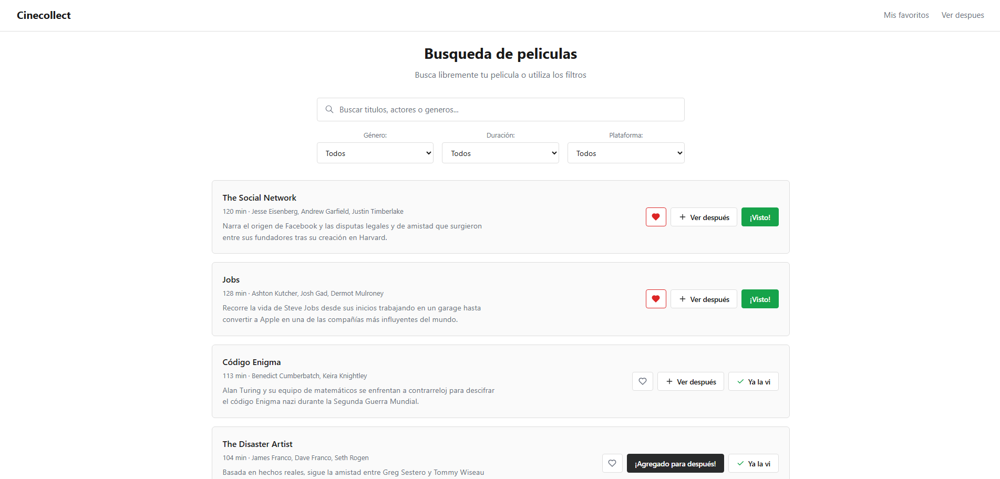
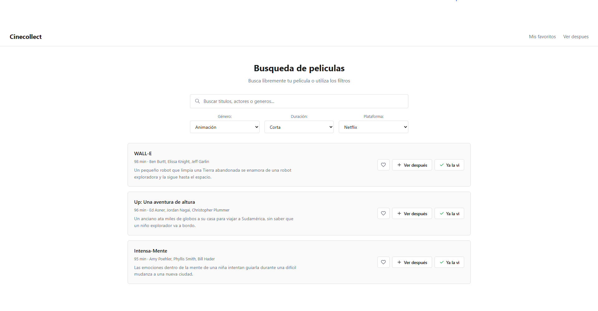
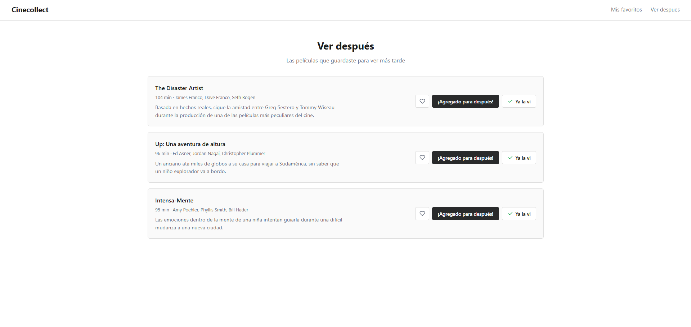
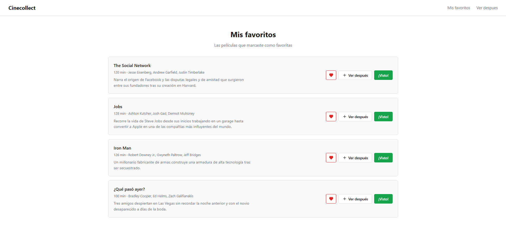

# Cinecollect

Aplicación web para explorar un catálogo de películas y llevar tu propia colección: marcar las que ya viste, guardar las que quieres ver después y tener una lista de favoritas.

Es un proyecto de práctica. Empezó como una página en HTML, CSS y JavaScript vanilla y lo migré a React con TypeScript. Es solo frontend y los datos son locales.



## Funcionalidades

- Catálogo de 54 películas con paginación.
- Búsqueda en vivo por título, actores o género, sin importar mayúsculas ni acentos.
- Filtros por género, duración y plataforma que se pueden combinar con la búsqueda.
- Marcar películas como vistas, agregarlas a "Ver después" o a favoritos, y quitarlas con un segundo clic.
- Páginas de **Ver después** y **Mis favoritos**.
- La colección se guarda en `localStorage`, así que no se pierde al recargar.

## Capturas



| Ver después | Mis favoritos |
|---|---|
|  |  |

## Tecnologías

- React 19 + TypeScript
- Vite
- React Router
- Context API y un custom hook (`useLocalStorage`) para el estado de la colección

## Estructura

```
client/src/
├── components/   # Header, CardPelicula, ListaPeliculas, Paginacion
├── context/      # Estado de la colección (vistas, ver después, favoritos)
├── data/         # Películas locales
├── hooks/        # useLocalStorage
└── pages/        # Inicio, Catalogo, VerDespues, Favoritos
```

## Cómo correrlo

```bash
cd client
npm install
npm run dev
```
